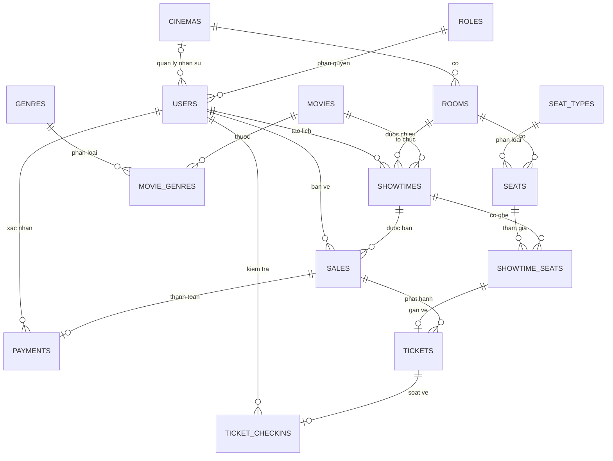

# HỆ THỐNG QUẢN LÝ RẠP PHIM

**Học phần:** Lập trình nâng cao  
**Bài nộp:** Bước 1 - Phân tích yêu cầu (40%) và Bước 2 - Thiết kế CSDL/ERD (60%)  
**Hướng công nghệ:** Java Spring Boot và Microsoft SQL Server

## Database Diagram (ERD)

**[📐 MỞ FILE THIẾT KẾ DBML ĐẦY ĐỦ (15 bảng)](database/He_thong_quan_ly_rap_phim_ERD.dbml)**

Để xem sơ đồ có đầy đủ cột, kiểu dữ liệu, PK, FK và chỉ mục, vào **https://dbdiagram.io**, tạo một sơ đồ mới, rồi sao chép nội dung file `.dbml` bên trên vào trình biên tập.

### Sơ đồ quan hệ tổng quan

> Sơ đồ Mermaid phía trên thể hiện các quan hệ chính. File DBML là nguồn thiết kế chi tiết dùng để kiểm tra PK, FK, kiểu dữ liệu và quan hệ N-N.

## Phạm vi MVP

- Quản lý rạp, nhân viên và phân quyền.
- Quản lý phim, thể loại, phòng chiếu, loại ghế và ghế.
- Lập suất chiếu và phát hiện trùng lịch.
- Bán vé tại quầy, thu tiền mặt hoặc xác nhận chuyển khoản thủ công.
- Phát hành vé, soát vé, thống kê số vé và doanh thu.

**Không nằm trong MVP:** AI gợi ý phim, ví điện tử, đặt vé trực tuyến, khuyến mãi, bán đồ ăn.

## Quy tắc nghiệp vụ quan trọng

1. Một phòng không được có hai suất chiếu chồng lấn, kể cả thời gian dọn phòng giữa hai suất.
2. Mỗi ghế chỉ có một bản ghi ở cùng một suất chiếu: `UNIQUE(showtime_id, seat_id)`.
3. Mỗi vị trí ghế theo suất chỉ phát hành tối đa một vé: `UNIQUE(showtime_seat_id)` trên `tickets`.
4. Vé trong hóa đơn phải cùng suất chiếu với hóa đơn; việc kiểm tra này cần xử lý bằng giao dịch/nghiệp vụ, không chỉ dựa vào khóa ngoại.
5. Một vé chỉ soát thành công một lần: `UNIQUE(ticket_id)` trên `ticket_checkins`.
6. Quan hệ phim và thể loại là N-N, đã tách thành bảng trung gian `movie_genres` có khóa chính ghép.

## Danh sách bảng (15)

`roles`, `cinemas`, `users`, `movies`, `genres`, `movie_genres`, `rooms`, `seat_types`, `seats`, `showtimes`, `showtime_seats`, `sales`, `payments`, `tickets`, `ticket_checkins`.

**Định hướng chuẩn hóa:** 3NF. Các ràng buộc liên bảng và chống bán vé đồng thời cần được hiện thực bổ sung ở tầng dịch vụ/giao dịch khi lập trình.

*Đây là bản thiết kế riêng cho học phần Lập trình nâng cao. Repo CineHunt khác chỉ được tham khảo và không bị thay đổi.*
